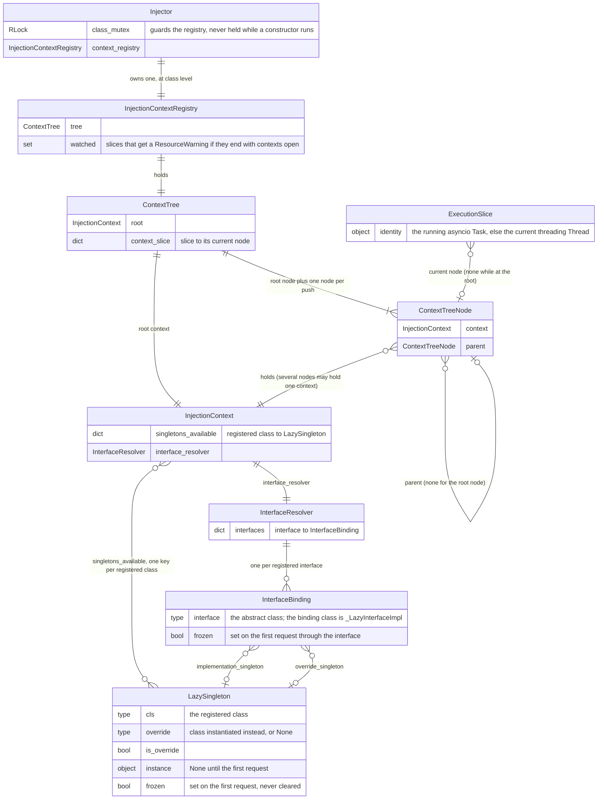
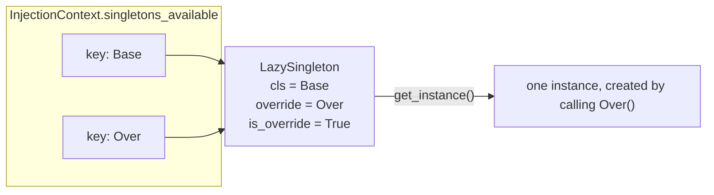

# Architecture

`Injector` is a static class: every decorator and every instance request goes through its class-level state. That
state is a single `InjectionContextRegistry`, which knows the root `InjectionContext` and, per execution slice, which
context is current. An `InjectionContext` is one registry of singletons (`dict[type, LazySingleton]`) and one
`InterfaceResolver` holding a binding per registered interface. Nothing in the library walks graphs: a lookup is at
most one interface binding followed by one `LazySingleton`, and the `LazySingleton` instantiates its override class if it
has one, else its own class.

## Entities

Cardinalities worth reading twice:

* **`InjectionContext` to `LazySingleton` is many-to-many.** Within one context, several keys map to one object:
  an overridden class and its override share a `LazySingleton` (see below), and a class overriding several singletons
  makes all of them share one. Across contexts, a `SHALLOW` child holds the same objects as its parent.
* **`ContextTreeNode` to `InjectionContext` is many-to-one.** A `PRESERVE` push and `Injector.foreign_context`,
  which `ContextAwareThread` uses, push an existing context again under a new node.
* **`ExecutionSlice` to `ContextTreeNode` is optional.** A slice appears in the tree only while it has a context
  pushed; with nothing pushed it reads the root context.

## Two registry keys, one `LazySingleton`

After `@Injector.override(Base)` is applied to `Over`, both classes are keys of the same registry entry. The object
keeps `Base` as its registered class and `Over` as its override class, and creates the instance by calling `Over`.
`Provide[Base]`, `Provide[Over]` and `Injector.get_instance` for either return that one instance; `Base` is never
instantiated through the injector.

Before the override, `Over` had its own `LazySingleton`. `Injector` discards it and re-points every registry key and
every interface binding that referred to it at the shared object. If the discarded one was frozen with an instance,
the shared object takes over that instance and the frozen state; if it was frozen without an instance, because the
constructor of `Over` was running or had failed, the override is refused with `SingletonFrozenError` (see
[concurrency.md](concurrency.md)).

## What happens on `Injector.get_instance(T)`

1. `Injector` takes its class mutex.
2. It asks `InjectionContextRegistry` for the current context. The registry determines the execution slice, the
   running `asyncio.Task` if there is one and otherwise the current `threading.Thread`, and `ContextTree` returns
   the context of that slice's current node, or the root context if the slice has nothing pushed.
3. If `T` is an interface registered in that context, `InterfaceResolver.get_binding(T)` returns its binding and
   `resolve()` freezes the binding, picks the override singleton if there is one and the implementation singleton
   otherwise, raises `RuntimeError` if there is neither, freezes the chosen `LazySingleton` and returns it.
   Otherwise `T` is looked up in `singletons_available` (`KeyError` if it is not registered there) and that
   `LazySingleton` is frozen.
4. The class mutex is released. Freezing and lookup happened as one step under it, so an override racing this request
   sees it either entirely before or entirely after itself.
5. `LazySingleton.get_instance()` sets the frozen flag again under its state lock, then takes its build lock. It
   records the calling thread; if that thread is already inside this constructor, directly or through dependencies,
   it raises `RuntimeError` for a circular dependency. If there is no instance yet it calls the override class if one
   is set and the registered class otherwise, stores the result and returns it. Another thread asking at the same
   time waits on the build lock and receives the same instance.

A `Provide[T]` parameter of an `@Injector.inject` function is filled with exactly this call, at every call of the
function, in the context current at that moment.

## What happens on `@Injector.override(What)`

`Injector.override(What, when=...)` runs under the class mutex. It calls `when()` once; if that returns `False` it
returns a decorator that does nothing. Otherwise it checks whether `What` is a registered interface in the current
context and returns the matching decorator. Applying that decorator to a class `Over` runs again under the class
mutex:

* **`What` is a singleton.** `Over` and `What` must both be registered in the current context, `Over` must be a
  subclass of `What` and not `What` itself, and `Over` must not be overridden by another class. The registry entry of
  `What` is then asked to take `Over` as its override class, which it refuses if it is frozen, already overridden, or
  an override itself, or if the entry so far registered for `Over` is frozen without an instance. On success the entry
  of `What` is marked as an override, adopts the instance of the discarded entry if that one had one, and is
  registered under `Over` as well; every other key and every interface binding that referred to the discarded entry
  is re-pointed at it. Every check runs before anything changes, so a refused override leaves both entries as they
  were.
* **`What` is an interface.** `Over` must be a registered singleton and a subclass of `What`. The interface's binding
  refuses if it is frozen, already has an override, or `Over` is its implementation; the `LazySingleton` of `Over`
  refuses to be marked as an override if `Over` is overridden by another class. On success the binding's
  `override_singleton` is the `LazySingleton` of `Over`, and `resolve()` prefers it over the implementation from
  then on.

The decorator returns `Over` unchanged in both cases.
