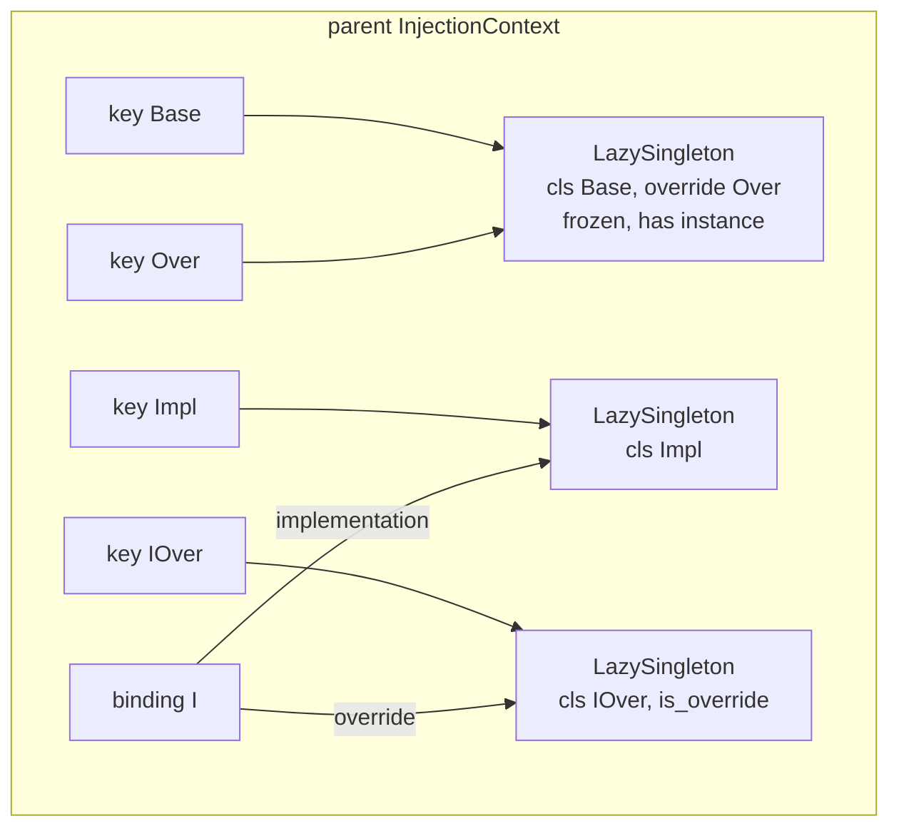
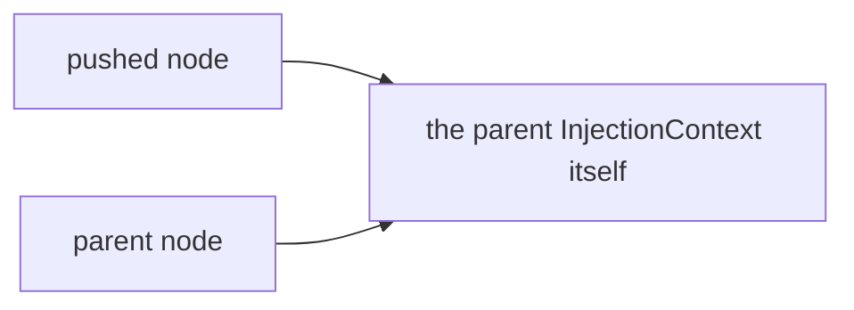
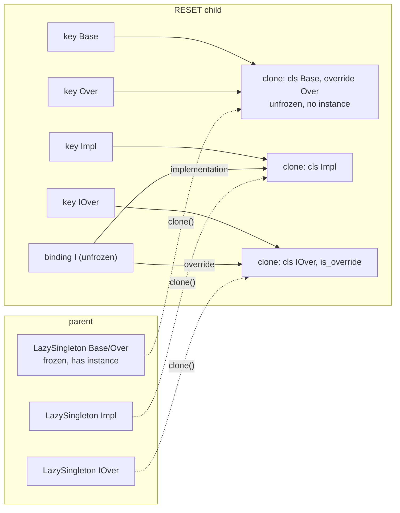
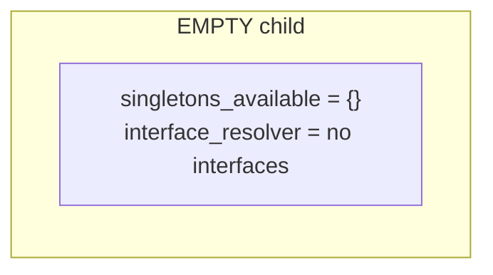
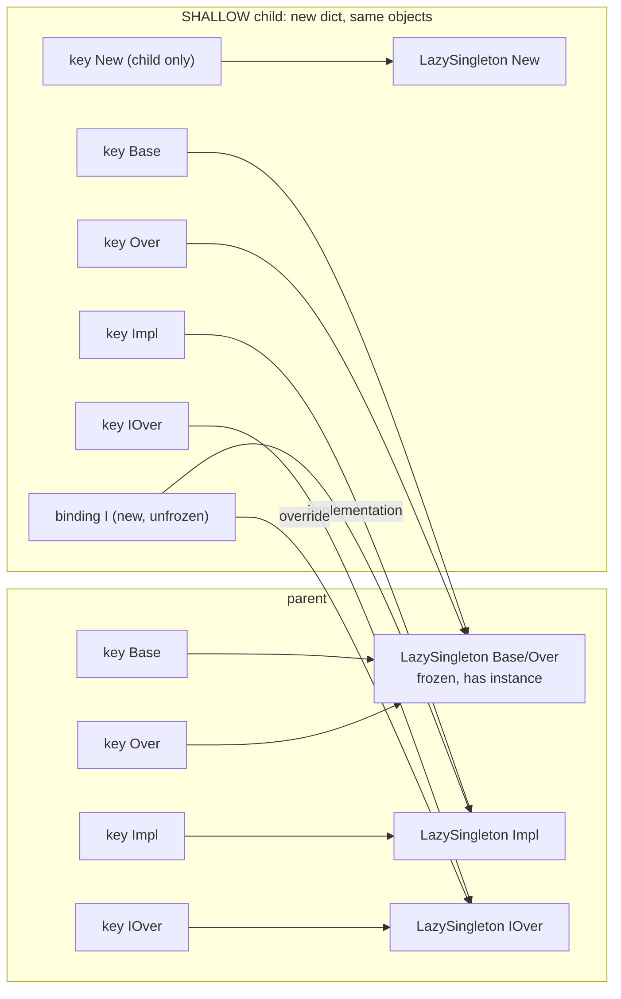
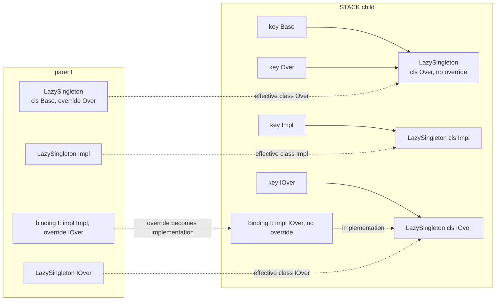
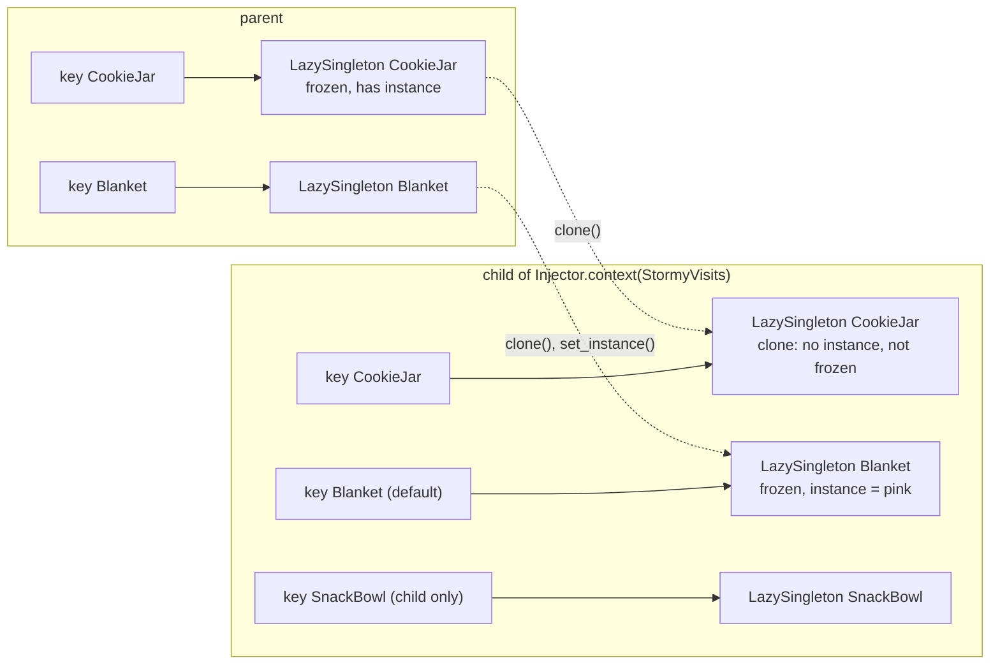
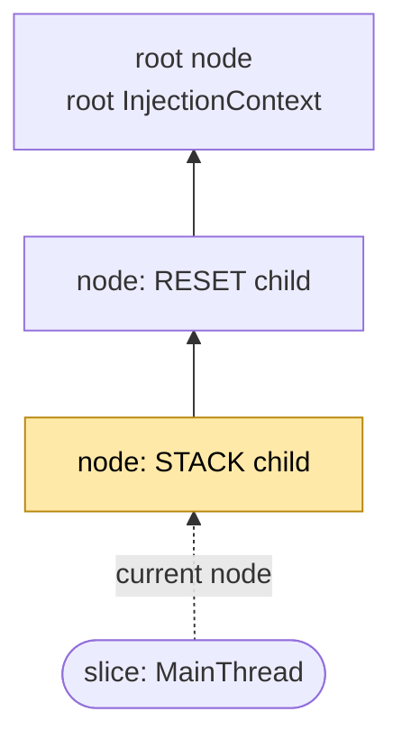
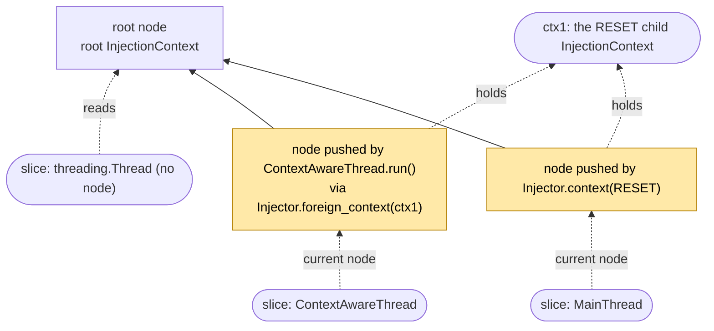
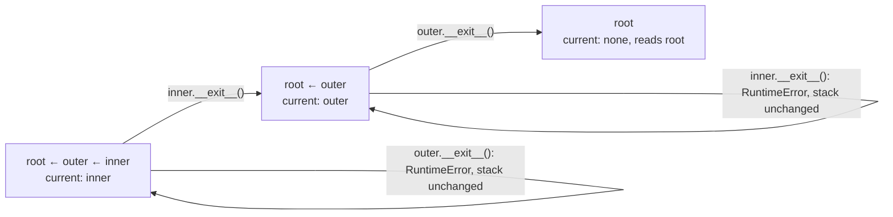

# Contexts

An injection context is one registry of singletons and one of interfaces. `Injector` always works on the *current*
context of the running execution slice: the root context, or the innermost context pushed on that slice with
`with Injector.context(kind):` or `with Injector.foreign_context(ctx):`. The [README](../README.md#contexts) has the
introductory example and the rules; this page shows the mechanics.

## Execution slices

Contexts are tracked per execution slice. A slice is the running `asyncio.Task` if code runs inside a Task, otherwise
the current `threading.Thread` object. Each slice has its own stack of pushed contexts; a slice with nothing pushed
sees the root context. `Injector.get_context()` returns the current slice's context.

* A native `threading.Thread` starts in the root context, regardless of the context of the thread that created it.
* `smalldi.thread.ContextAwareThread` captures the creator's current `InjectionContext` in `__init__`, by reference
  and not as a copy, and enters it with `Injector.foreign_context` for the duration of `run()`.
* An `asyncio.Task` starts in the root context. Opening injection contexts inside coroutines is not supported.
  `@Injector.inject` on an `async def` returns a coroutine function and resolves `Provide[T]` when the coroutine starts
  running, in the context current at that moment.
* If a slice ends with contexts still open, they are removed and a `ResourceWarning` is emitted.

## The context manager

`Injector.context(kind)` and `Injector.foreign_context(ctx)` return a single-use `InjectionContextManager`:

* Nothing is pushed until `__enter__`.
* For `RESET`, `STACK` and `SHALLOW`, the child is built at `__enter__` time from the context current then, so a
  singleton registered between creating the manager and entering it is part of the child.
* `__enter__` returns the `InjectionContext` it pushed.
* `__exit__` pops exactly the context this manager pushed. Exiting out of order raises `RuntimeError` and leaves the
  stack unchanged. Entering the same manager twice raises `RuntimeError`, also after it was exited.

```python
from smalldi import Injector

root = Injector.get_context()
outer = Injector.context()
inner = Injector.context()
outer_ctx = outer.__enter__()
inner_ctx = inner.__enter__()

try:
    outer.__exit__(None, None, None)          # out of order: inner is still open
except RuntimeError as e:
    print(type(e).__name__)                   # RuntimeError
print(Injector.get_context() is inner_ctx)    # True

inner.__exit__(None, None, None)
print(Injector.get_context() is outer_ctx)    # True
outer.__exit__(None, None, None)
print(Injector.get_context() is root)         # True

try:
    outer.__enter__()                         # a manager is single-use
except RuntimeError as e:
    print(type(e).__name__)                   # RuntimeError
```

## Context kinds

`Injector.context(kind)` takes a member of `smalldi.context.InjectionSubcontextType`; `RESET` is the default. The
diagrams below start from the same parent: `Base` is overridden by `Over`, so both keys share one `LazySingleton`
that already has an instance and is frozen; interface `I` is implemented by `Impl` and overridden by `IOver`.



### PRESERVE

The child *is* the parent: the same `InjectionContext` object is pushed again. Everything registered, overridden or
instantiated inside the block is registered, overridden or instantiated in the parent.



### RESET

Same registrations, implementations and overrides; every singleton is a fresh, unfrozen `LazySingleton` without an
instance. Keys that shared one object in the parent share one clone, so `Base` and `Over` still resolve to one
instance. Interfaces are rebound to the new singletons, with unfrozen bindings.



Nothing created inside the child reaches the parent: instances, overrides and registrations made in the block are
gone after it, and the parent's instances and frozen flags are untouched.

### EMPTY

Nothing registered: no singleton and no interface. A `Provide[T]` function decorated at the root can still be called
inside, but `Injector.get_instance(T)` raises `KeyError` for a class that isn't registered in the current context.



### SHALLOW

A new registry dict holding the *same* `LazySingleton` objects as the parent, so instances and frozen state are shared.
A singleton registered inside is a new key in the child's dict only, invisible to the parent. Interfaces get new,
unfrozen bindings that refer to the shared objects.

**Caveat.** Overriding an inherited singleton inside a `SHALLOW` block mutates the shared `LazySingleton`: it gets
the override class, and the parent resolves to the override's instance from then on, even though the overriding class
itself is registered in the child only.



```python
from smalldi import Injector
from smalldi.context import InjectionSubcontextType

with Injector.context(InjectionSubcontextType.RESET):
    @Injector.singleton
    class Base:
        pass

    with Injector.context(InjectionSubcontextType.SHALLOW):
        @Injector.override(Base)
        @Injector.singleton
        class Over(Base):
            pass

    print(Injector.is_singleton(Over))                     # False
    print(type(Injector.get_instance(Base)).__name__)      # Over
```

### STACK

Each singleton's effective class, its override if it has one and its own class otherwise, becomes the base of a
fresh singleton with no override, no instance and no frozen flag. Keys that shared one object keep sharing one. An
interface's override becomes its implementation, so the interface can be overridden again inside the block.



## Declared contexts

`smalldi.context.InjectionContextSingletonOverride` builds a `SHALLOW` child from the fields of a dataclass subclass.
`Injector.context` takes the subclass, whose defaults are the values, or an instance of it, whose attributes are;
`apply(context)` on either derives the same child from a given context and returns it unpushed. Each field is one of:

| Field                   | Effect on the child                                                                                                                              |
|-------------------------|--------------------------------------------------------------------------------------------------------------------------------------------------|
| `n: T`                  | The child's own `LazySingleton` for `T`: a registered `T` is cloned as `RESET` clones it, and keys that shared `T`'s object share the clone; an unregistered `T` is registered in the child only. `T` is a concrete class: an abstract one, registered as an interface or not, raises `TypeError` when the manager is created. |
| `n: T = instance`       | The child's singleton for `T` gets `instance` and is frozen. The parent never sees it.                                                            |

`Injector.context` dispatches on its argument: a member of `InjectionSubcontextType` takes the kind path, with `RESET` as
the default; a subclass of `InjectionContextSingletonOverride` and an instance of one take
the declared path, reading the fields' defaults or the instance's attributes when the manager is created. Default
factories run then, before any lock is taken, in the class form only. The child is built at `__enter__`, under the
injector's class mutex, from the context current then; the parent's dict and `LazySingleton` objects are only read,
and the child's dict is private until it is pushed. The parent's interfaces are rebound in the child to the clones
where their singletons are declared.



```python
import dataclasses

from smalldi import Injector
from smalldi.context import InjectionContextSingletonOverride

with Injector.context():
    @Injector.singleton
    class CookieJar:
        pass

    @Injector.singleton
    class Blanket:
        pass

    class SnackBowl:
        pass

    pink = Blanket()

    @dataclasses.dataclass
    class StormyVisits(InjectionContextSingletonOverride):
        jar: CookieJar
        bowl: SnackBowl
        blanket: Blanket = pink

    outer_jar = Injector.get_instance(CookieJar)
    with Injector.context(StormyVisits):
        print(Injector.get_instance(CookieJar) is outer_jar)   # False: the block's own singleton
        print(Injector.get_instance(Blanket) is pink)          # True
        print(Injector.is_singleton(SnackBowl))                # True
    print(Injector.get_instance(CookieJar) is outer_jar)       # True
    print(Injector.get_instance(Blanket) is pink)              # False: the parent's Blanket is its own
    print(Injector.is_singleton(SnackBowl))                    # False
```

## Context trees

`ContextTree` keeps one node per push. A node knows its parent only; a slice's stack is the chain from its current
node up to the root node. The nodes of all slices together form one tree rooted at the root context.

### (a) One thread: root, RESET, STACK

The main thread entered `Injector.context(RESET)` and, inside it, `Injector.context(STACK)`. Its current node is the
`STACK` one; both blocks are still open.



### (b) A `ContextAwareThread` and a plain thread created inside a RESET block

The main thread is inside a `RESET` block whose context is `ctx1`. A `ContextAwareThread` created there captured
`ctx1` and, in its `run()`, pushed it with `Injector.foreign_context` on its own stack: a second node, whose parent
is the root node, holding the *same* `InjectionContext` object. A plain `threading.Thread` created at the same place
has no node and reads the root context.



Both threads register into, override in and create instances in `ctx1`. Access to the shared context is safe only
because every access goes through `Injector` under its class mutex (see [concurrency.md](concurrency.md)).

### (c) Unwinding the stack, and an out-of-order exit

Two managers, `outer` and `inner`, were entered in that order on one slice. Each `__exit__` pops exactly the node
its manager pushed, so only the innermost open manager may exit. Exiting `outer` while `inner` is open raises
`RuntimeError` and changes nothing; the slice's current node stays `inner`'s.



A slice that finishes with nodes still on its stack has them popped by the registry, which emits one
`ResourceWarning` naming the slice and the number of contexts it left open.

```python
import threading
import warnings

from smalldi import Injector


def forgetful():
    Injector.context().__enter__()   # never exited


with warnings.catch_warnings(record=True) as caught:
    warnings.simplefilter("always")
    thread = threading.Thread(target=forgetful)
    thread.start()
    thread.join()

print([w.category.__name__ for w in caught])   # ['ResourceWarning']
```

## Registration and the import caveat

A decorator registers into the context that is current when it runs. Python imports a module once and caches it,
so a module first imported inside a `with Injector.context(...)` block registers its singletons and interfaces in
that context only: after the block they are gone, and importing the module again at the root runs nothing. Import
the modules that register singletons at the root, before opening contexts; `Collector.collect_from_package` is a
way to do that for a whole package.

## Coroutines

An `asyncio.Task` is its own execution slice and starts in the root context. Opening injection contexts inside
coroutines is not supported. `@Injector.inject` on an `async def` function returns a coroutine function; its
`Provide[T]` parameters are resolved when the coroutine starts running, not when the function is called.

```python
import asyncio
import inspect

from smalldi import Injector, Provide


@Injector.singleton
class Service:
    pass


@Injector.inject
async def use(service: Provide[Service]) -> str:
    return type(service).__name__


print(inspect.iscoroutinefunction(use))   # True
print(asyncio.run(use()))                 # Service
```
